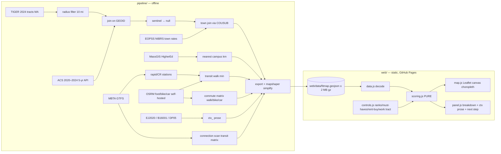

# Design Document — FitMap

## Overview

FitMap is two programs joined by one file:

1. **Pipeline** (Python, offline, run once): fetches public data, joins it per census tract on GEOID, precomputes tract-to-tract commute times, and writes `web/data/fitmap.geojson`.
2. **Frontend** (vanilla JS + Leaflet, static): loads that file, scores tracts client-side from the user's priorities, recolors a canvas choropleth live, and explains each tract.

No backend, no runtime API, no billing. Deployed to GitHub Pages.



## Architecture decisions

| # | Decision | Rationale |
|---|---|---|
| D1 | Center point = Boston City Hall, (42.3603, −71.0580); radius 10 statute miles = 16.0934 km; tract included iff its TIGER internal point is within radius | Locked radius is 10 mi "around Boston"; reference doc does not fix a center — City Hall chosen (flagged). Internal-point test is deterministic and avoids sliver inclusion. |
| D2 | Counties queried: Suffolk 025, Middlesex 017, Norfolk 021, Essex 009, Plymouth 023 (state 25), then radius-filtered | Superset guarantees coverage; filter decides membership. |
| D3 | Subscores are mid-rank percentiles over the full study area | Matches locked "relative order is the reliable signal" (buy-value audit); unit-free so criteria are comparable; monotone by construction; no hand-tuned dollar breakpoints. |
| D4 | Weights from importance rank = Rank-Order-Centroid (ROC) | Standard MCDA rank→weight method; positive, strictly decreasing, sums to 1, needs no tuning constants. |
| D5 | Missing nice-to-have value → renormalize weights for that tract and flag it | Avoids penalizing tracts for Census suppression while staying honest in the breakdown. |
| D6 | Commute vectors = base64 Uint8 minutes, 255 = no route/over cap | 4 modes × N² bytes fits the 2 MB gzip budget for N≈450–650; whole minutes are adequate precision. |
| D7 | Transit commute uses all GTFS modes (incl. bus); transit-accessibility criterion uses only route_type 0/1/2 stations | Commute should reflect real trips; the accessibility axis is specifically "nearest rapid-transit + commuter-rail station". Silver Line (bus, route_type 3) excluded from accessibility — flagged. |
| D8 | Crime value = rate per 1,000 residents; user picks "Serious (crimes against persons)" [default] or "All (persons + property)" | Locked scope says "petty vs serious"; NIBRS's own Group A categories avoid inventing a severity weighting. |
| D9 | Car = OSRM free-flow | No traffic data in the locked stack; labeled in UI. |

## Components and Interfaces

### Pipeline (`pipeline/src/fitmap_pipeline/`)

CLI: `uv run python -m fitmap_pipeline <stage>` where stage ∈ `geography | census | crime | campus | stations | osrm | transit | prose | export | build` (`build` runs all in order). Each stage reads/writes Parquet/JSON under `pipeline/data/interim/` (gitignored) so stages are independently re-runnable.

Pure functions (property-tested):

```python
def null_sentinels(x: float | int | None) -> float | None      # negative → None
def in_radius(lat: float, lon: float, center=(42.3603, -71.0580), miles=10.0) -> bool
def burden_pct(b25070: dict[str, int|None], b25091: dict[str, int|None]) -> float | None
def town_rate(offenses: int, population: int) -> float | None   # per 1,000; None if pop<=0
def encode_minutes(seconds: list[float | None]) -> str          # base64 Uint8, 255 sentinel
def decode_minutes(b64: str) -> list[int]
```

- **burden_pct** = 100 × (Σ renter cats 30.0–34.9, 35.0–39.9, 40.0–49.9, ≥50.0 [B25070_007..010] + Σ owner cats with and without mortgage 30%+ [B25091_008..011, B25091_019..022]) ÷ (B25070_001 − B25070_011 + B25091_001 − B25091_012 − B25091_023). Variable IDs verified against `api.census.gov/data/2024/acs/acs5/groups/B25070.json` and `B25091.json`. Denominator 0 → None.
- **Value top-code**: `value_topcoded = estimate >= 2_000_000` (ACS top-code bin "$2,000,000 or more"). Rent (B25064) top-code: the implementer must read the current ACS top-code from Census documentation/API and record it in `config.py`; do not guess.
- **OSRM**: Docker `osrm/osrm-backend`, MA extract from Geofabrik, three datasets (`foot.lua`, `bicycle.lua`, `car.lua`), MLD pipeline. Query `table/v1/{profile}` in chunks (≤ 100 sources × all destinations) to stay under default `max-table-size`; start the server with `--max-table-size` large enough or chunk.
- **Transit**: Connection Scan Algorithm over GTFS weekday service on the build date's next Wednesday, departures 07:30/08:00/08:30; access/egress = OSRM foot from tract internal point to stops within 1.2 km straight-line; transfers from `transfers.txt` + same `parent_station`; walk-only alternative always considered (transit time = min(transit, walk)). Result = median of the three departure times.
- **Crime**: EOPSS NIBRS (Massachusetts crime statistics portal) for the most recent complete year; implementer records the exact URL, year, and download date in `pipeline/data/SOURCES.md`. If the data cannot be obtained, crime fields are null, the criterion is shown as "unavailable" and the README says so — never fabricated.
- **Prose**: B16001 (if not published at tract level for 2024 5-yr, use C16001 and say so), DP05 race/ethnicity percentages resolved **by label** from the DP05 groups endpoint (DP05 variable numbers shift between vintages — do not hard-code). EJ2020: refetch the MassGIS EJ2020 layer with `outFields=GEOID,EJ,EJ_CRIT_DESC` (the staged CSV lacks GEOID); tract = first 11 digits of block-group GEOID.

### Frontend (`web/js/`)

`scoring.js` — **pure**, no DOM, no Leaflet, no `Math.random`, no `Date`:

```js
export const CRITERIA = ['rent','value','burden','commute','transit','campus','crime']; // all lower-is-better
export function rocWeights(rankedKeys)                      // → {key: weight}, Σ=1
export function percentileTables(features, keys)            // → {key: sortedValues[]} over full study area
export function subscore(value, sortedValues)               // mid-rank percentile, 1 = best, [0,1]
export function evaluate(featureProps, state, tables)       // → {status:'scored'|'excluded'|'nodata', score?, parts[], failed[]}
export function scoreAll(features, state)                   // → Map<geoid, result>
```

`state` = `{ mode: 'rent'|'buy', ranks: string[], mustHave: {key: bool}, threshold: {key: number|null}, workIdx: number|null, modes: {walk,bike,car,transit: bool}, crimeScope: 'serious'|'all' }`.

Algorithm for one tract:
1. `active` = `ranks` filtered to drop `value` (if mode=rent) or `rent` (if mode=buy), and `commute` if `workIdx === null`.
2. Criterion value: `commute` = min over enabled modes of `vec[mode][workIdx]` (255 kept as worst); `crime` = serious or serious+property rate per `crimeScope`; others read directly.
3. Must-have check: for each active key with `mustHave[key]` and `threshold[key] != null`: value null → `nodata`; value > threshold → add to `failed`. Any failed → `excluded`.
4. `w = rocWeights(active)`. Available = active keys with non-null value. None available → `nodata`. Else score = 100 × Σ_{k∈avail} w_k·s_k ÷ Σ_{k∈avail} w_k, clamped to [0,100] and rounded to 1 decimal **only for display**.

ROC weights for k ranked keys: `w_i = (1/k) · Σ_{j=i}^{k} 1/j` (i = 1 is most important).

Mid-rank percentile subscore of value v in sorted array A (n = |A|, all non-null study-area values, v ∈ A): `s = (count(a > v) + 0.5·(count(a == v) − 1)) / (n − 1)`, and `s = 1` when n = 1. Higher s = better (lower raw value).

`map.js` — Leaflet `L.map(..., {preferCanvas: true})`; style function reads `scoreAll` results; 5-class sequential palette on score; excluded = grey diagonal pattern; nodata = grey dots; buy-value view uses quintile classes + separate "$2M+" class + hatching where `value_moe_high`.

`controls.js` — Rent/Buy switch; per criterion: rank up/down buttons (keyboard), must-have checkbox, threshold input with units; mode checkboxes (walk/bike/car/transit); crime scope radio; "Set work location" button → next map click snaps to tract via point-in-polygon on loaded geometry.

`panel.js` — breakdown table (value + units, subscore, weight, contribution, must-have pass/fail), missing-data flags, `ctx_` prose block, next-step list from `web/data/next-steps.json`, empty-state explainer (counts tracts failed per must-have; names the max).

## Data Models

### `web/data/fitmap.geojson`

FeatureCollection; features sorted by `geoid`; geometry simplified with mapshaper (Visvalingam, keep-shapes, coordinate precision 5 decimals).

| Property | Type | Notes |
|---|---|---|
| `geoid` | string `^\d{11}$` | unique |
| `idx` | int | = array position; indexes commute vectors |
| `name` | string | tract NAMELSAD |
| `town` | string | COUSUB name |
| `lat`,`lon` | number | internal point |
| `rent` | number ≥ 0 \| null | B25064, USD/month |
| `rent_moe` | number ≥ 0 \| null | |
| `value` | number ≥ 0 \| null | B25077, USD |
| `value_moe` | number ≥ 0 \| null | |
| `value_topcoded` | bool | |
| `value_moe_high` | bool | MOE/estimate > 0.30 |
| `burden` | number [0,100] \| null | % households cost-burdened |
| `burden_renter`,`burden_owner` | number [0,100] \| null | |
| `crime_serious`,`crime_property` | number ≥ 0 \| null | per 1,000 residents, town-level |
| `crime_year` | int \| null | |
| `campus` | number ≥ 0 \| null | km to nearest campus |
| `campus_name` | string \| null | |
| `transit` | number ≥ 0 \| null | walk minutes to nearest station |
| `transit_station` | string \| null | |
| `cm_walk`,`cm_bike`,`cm_car`,`cm_transit` | string | base64 Uint8[N] minutes, 255 = none |
| `ctx_lang` | object \| null | prose inputs; never scored |
| `ctx_race` | object \| null | prose inputs; never scored |
| `ctx_ej` | object \| null | `{bg_count, criteria[]}`; never scored |

Top-level `metadata`: `{acs_vintage:"2020-2024", center:[lat,lon], radius_mi:10, built_at, sources:[...]}` (foreign member, allowed by RFC 7946).

## Error Handling

- Census sentinel → null at ingest (never later). Null propagates as "not enough data", never as 0.
- OSRM unreachable → stage fails loudly; no partial matrix written.
- No route → 255, treated as worst commute.
- GTFS service-day with no trips → stage fails with message (don't silently produce all-walk times).
- Crime data unobtainable → crime nulls + UI "unavailable" (D8 fallback), documented in README.
- Frontend: work click outside study area → message, state unchanged. Zero passing tracts → empty state.

## Correctness Properties

*A property is a characteristic that must hold across all valid executions. Each is implemented as a property-based test (hypothesis for Python, fast-check for JS) with ≥ 200 generated cases and tagged with the property number.*

**Property 1: Score bounds** — *For any* feature set and any valid state, every tract with status `scored` has 0 ≤ score ≤ 100.
**Validates: Requirements 7.3, 7.4**

**Property 2: Weights form a distribution** — *For any* non-empty ranking of distinct criterion keys, `rocWeights` returns one weight per key, each in (0, 1], strictly decreasing with rank, summing to 1 within 1e-9.
**Validates: Requirement 7.2**

**Property 3: Determinism** — *For any* feature set and state, calling `scoreAll` twice yields identical results.
**Validates: Requirement 7.7**

**Property 4: Order independence** — *For any* feature set and state, shuffling feature order (keeping `idx`-indexed vectors consistent) or permuting the listing order of `mustHave`/`threshold` keys does not change any tract's result.
**Validates: Requirement 7.7**

**Property 5: Monotonicity** — *For any* feature set, state, tract t, and criterion k active for t with non-null value, replacing t's k-value with a strictly better (lower) non-null value never lowers t's score, and never turns a passing tract into an excluded one.
**Validates: Requirement 7.8**

**Property 6: Must-have exclusion** — *For any* state where criterion k is must-have with threshold θ, every tract whose k-value > θ has status `excluded`, has no score, and lists k in `failed`.
**Validates: Requirements 8.2, 8.3**

**Property 7: Rank sensitivity is consistent** — *For any* tract and two active criteria a, b with non-null values and subscores s_a > s_b, where b is ranked above a, swapping the rank positions of a and b (all other positions unchanged) never lowers that tract's score.
**Validates: Requirements 7.2, 8.6**

**Property 8: GEOID integrity** — *For any* pipeline output, every feature's `geoid` matches `^\d{11}$`, all GEOIDs are unique, features are sorted by GEOID, and `idx` equals position.
**Validates: Requirements 1.3, 1.4**

**Property 9: No negative quantities** — *For any* raw ACS/crime/routing input (including sentinel codes), every emitted `rent`, `value`, MOE, `burden*`, `crime_*`, `campus`, `transit` is null or ≥ 0, and burden is ≤ 100.
**Validates: Requirements 2.2, 2.3, 3.3**

**Property 10: Sentinels never survive** — *For any* integer input, `null_sentinels` returns None for every negative input and the input unchanged otherwise.
**Validates: Requirement 2.2**

**Property 11: Commute encoding round-trip** — *For any* list xs of non-negative seconds or None, `decode_minutes(encode_minutes(xs))` has the same length as xs and element i equals `round(xs[i]/60)` when xs[i] is not None and that value is ≤ 254, else 255.
**Validates: Requirement 6.3**

**Property 12: Context fields are never scored** — *For any* feature set and state, arbitrarily changing any `ctx_*` property of any tract leaves every tract's result unchanged; and the source text of `scoring.js` contains no `ctx_` reference.
**Validates: Requirements 7.1, 12.1, 12.2**

**Property 13: Radius membership** — *For any* (lat, lon), `in_radius` is true iff the haversine distance to the center is ≤ 16.0934 km.
**Validates: Requirement 1.1**

**Property 14: Subscore bounds and orientation** — *For any* non-empty array A and v ∈ A, `subscore(v, A)` ∈ [0, 1]; the minimum of A scores ≥ every other element.
**Validates: Requirement 7.3**

## Testing Strategy

- **Pipeline**: `pytest` + `hypothesis` for Properties 8–11, 13 (pure functions + a schema test on the real output file). Example tests for burden formula on a hand-computed tract.
- **Frontend**: `node --test` + `fast-check` for Properties 1–7, 12, 14 against `scoring.js` with generated feature sets (2–60 tracts, random nulls, random 255s, random states).
- **Output gate**: `scripts/hooks/check_geojson.py` (schema + size), run by Kiro hooks and before deploy.
- **Manual demo check**: the < 3 min demo path in `product.md`.
